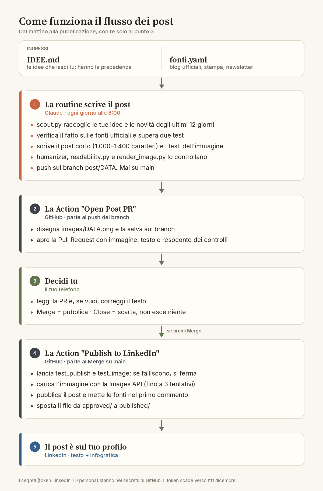

# LinkedIn Content: l'AI per chi parte da zero

Post LinkedIn scritti da una routine Claude per il profilo di Marco Parolin. Ogni
post lascia a chi legge una cosa da provare oggi con l'assistente AI che usa
(Claude, ChatGPT, Gemini, Copilot): un trucco, una funzione, un errore da
evitare, un caso d'uso da un mestiere non informatico. Dal 23 ottobre 2026 ogni
post esce con un carosello, con l'illustrazione della copertina disegnata da
ChatGPT.

## Flusso

In breve: la routine (ogni giorno alle 7:55) scrive `approved/DATA.md` e fa push del
branch `post/DATA`. La Action "Open Post PR" chiede l'illustrazione a OpenAI,
disegna il carosello e apre la PR con le slide. Marco dal
telefono decide: Merge = pubblica su LinkedIn, Close = scarta. Lo schema è
un'immagine fissa: se il flusso cambia, va rifatta.

## File da conoscere

- `IDEE.md`: dove incollare gli spunti (reel, video, trucchi). La routine li usa per primi.
- `fonti.yaml`: le fonti che la routine scansiona.
- `STYLE.md`: linea editoriale, voce, angoli, divieti.
- `ROUTINE_PROMPT.md`: copia del prompt della routine.
- `SETUP.md`: architettura, rete, soglie di forma, token LinkedIn, problemi noti.
